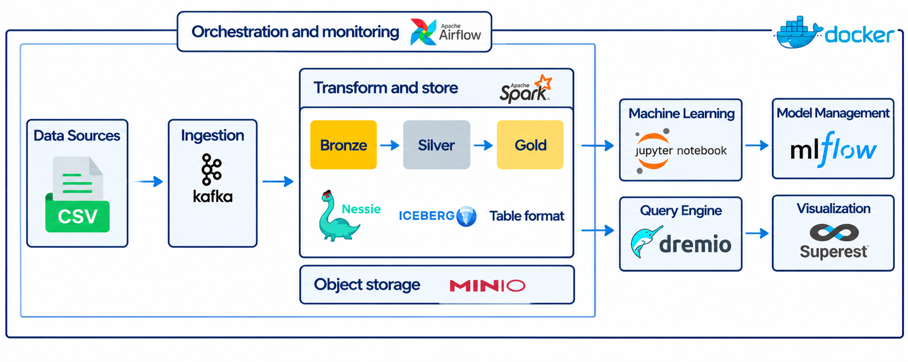

- Compose up zookerper bị lỗi không sao
- Tạo 2 thư mục landing, processed trong notebooks/dataverse_files sao khi compose up docker
- Bỏ 2 file survey.csv, amazon-purchases.csv vào thư mục landing
# 🛒 LakeHouse Ecommerce

**A Modern Data Stack project for E-commerce Analytics and Customer Behavior Prediction.**

An end-to-end Data Lakehouse platform integrating data ingestion, distributed processing, analytics, and machine learning using open-source technologies.

## 📑 Table of Contents

- [Architecture](#-architecture)
- [Technology Stack](#-technology-stack)
- [Data Pipeline](#-data-pipeline)
- [Machine Learning](#-machine-learning)
- [Project Structure](#-project-structure)

## 🏗️ Architecture

The system follows the **Medallion Architecture**, organizing data into Bronze, Silver, and Gold layers.

## 🧰 Technology Stack

| Category | Technologies |
|---|---|
| Containerization | Docker, Docker Compose |
| Ingestion | Python, Apache Kafka |
| Processing | Apache Spark |
| Storage | MinIO, Apache Iceberg |
| Catalog | Project Nessie |
| Orchestration | Apache Airflow |
| Analytics | Dremio, Apache Superset |
| Machine Learning | Scikit-learn, XGBoost |
| Model Management | MLflow |
| Interactive Application | Streamlit, Jupyter Notebook |

## 🔄 Data Pipeline

1. **Ingestion:** Load purchase data from CSV files using Python and Kafka.
2. **Bronze:** Store raw data in the Lakehouse.
3. **Silver:** Clean and transform data using Apache Spark.
4. **Gold:** Prepare analytical datasets and customer features.
5. **Analytics:** Query data using Dremio and visualize insights with Superset.

Apache Airflow orchestrates the configured data workflows.

## 🤖 Machine Learning

Build regression models to predict:

- **Average Annual Spending:** Estimate customer spending.
- **Average Annual Order Count:** Estimate customer order frequency.

**Models:** Random Forest Regression and XGBoost Regression.

**MLflow:** Track experiments, evaluation metrics, and model artifacts.

**Streamlit:** Provide an interactive interface for customer analysis, prediction visualization, and scenario simulation.
